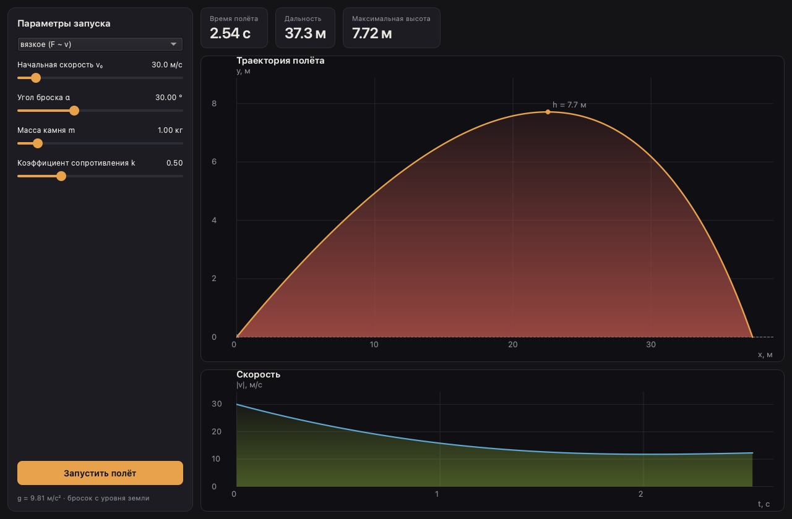

# Полёт камня 🪨

Нативное настольное приложение — лабораторная работа по механике.

Камень бросается под углом к горизонту. Программа интегрирует уравнения движения,
рисует траекторию и считает, куда упадёт камень, с учётом сопротивления воздуха
в двух моделях:

- вязкое трение $F \sim v$
- лобовое сопротивление $F \sim v^2$

Слева — параметры запуска, сверху — метрики полёта, ниже — графики траектории
и скорости (наведите курсор, чтобы получить точные значения). Кнопка
«Запустить полёт» анимирует движение камня вместе с вектором скорости.




## Запуск

Нужен [uv](https://docs.astral.sh/uv/):

```shell
curl -LsSf https://astral.sh/uv/install.sh | sh   # или brew install uv
```

Синхронизировать зависимости и запустить приложение:

```shell
uv sync
uv run rockthrow
```

Эквивалентно: `uv run python -m rockthrow`.


## Тесты

Оракулы с аналитическими решениями из условия лабораторной (без сопротивления
и с линейным сопротивлением) плюс проверка инвариантов:

```shell
uv run pytest
```

Линт и автоформатирование:

```shell
uv run ruff check .
uv run ruff format .
```


## Структура

```
src/rockthrow/
├── physics/       # модель полёта, без зависимостей от интерфейса
│   ├── drag.py    #   модели сопротивления: линейная F ∼ v и квадратичная F ∼ v²
│   └── flight.py  #   интегрирование полёта (RK45, событие касания земли)
├── ui/            # нативный интерфейс PySide6
│   ├── controls.py          # панель параметров запуска
│   ├── metrics.py           # плитки результатов
│   ├── plot_canvas.py       # базовый канвас: сетка, оси, перекрестье
│   ├── trajectory_canvas.py # траектория + анимация камня
│   └── velocity_canvas.py   # скорость от времени
└── app.py         # точка входа: приложение, тёмная палитра, главное окно
```

Данные параметры и обоснования границ — в [описании лабораторной](docs/lab.md).
