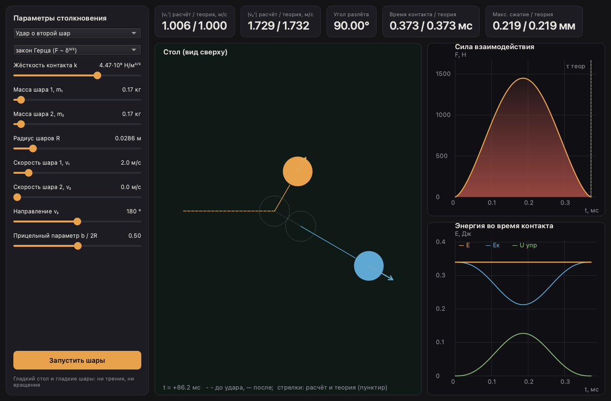

# Бильярд на гладком столе 🎱

Нативное настольное приложение — лабораторная работа по механике.

Идеально гладкий шар налетает на другой шар или на неподвижную стенку. Удар
моделируется детально: шары деформируются, и программа численно решает
уравнения второго закона Ньютона для обоих шаров с силой отталкивания по
линии центров

- по закону Гука $F = k\,\delta$
- по закону Герца $F = k\,\delta^{3/2}$

где $\delta = 2R - |\vec r_1 - \vec r_2|$ — взаимное сжатие. Результат
сравнивается с мгновенным упругим ударом из законов сохранения импульса и
энергии, а время контакта и максимальное сжатие — с аналитическими формулами.

Слева — параметры удара (лобовой или под углом, равные или разные массы,
покоящийся или движущийся второй шар, стенка), сверху — скорости после удара,
угол разлёта, время контакта и сжатие (расчёт / теория), ниже — стол с
траекториями и векторами скоростей (сплошные — расчёт, пунктир — законы
сохранения), сила взаимодействия и энергия во время контакта (наведите курсор,
чтобы получить точные значения). Кнопка «Запустить шары» анимирует движение.




## Запуск

Нужен [uv](https://docs.astral.sh/uv/):

```shell
curl -LsSf https://astral.sh/uv/install.sh | sh   # или brew install uv
```

Синхронизировать зависимости и запустить приложение:

```shell
uv sync
uv run billiards
```

Эквивалентно: `uv run python -m billiards`.


## Тесты

Оракулы: скорости после удара из законов сохранения (лобовой удар, удар под
углом, разлёт под 90° при равных массах, отражение от стенки), аналитические
время контакта и максимальное сжатие для обоих законов, плюс сохранение
импульса и полной энергии $E_к + U$ на всём протяжении контакта:

```shell
uv run pytest
```

Линт и автоформатирование:

```shell
uv run ruff check .
uv run ruff format .
```


## Структура

```
src/billiards/
├── physics/          # модель удара, без зависимостей от интерфейса
│   ├── contact.py    #   законы контакта: Гук F ∼ δ и Герц F ∼ δ³ᐟ²
│   ├── collision.py  #   интегрирование фазы контакта (DOP853, событие разлёта δ = 0)
│   └── theory.py     #   законы сохранения, время контакта и сжатие
├── ui/               # нативный интерфейс PySide6
│   ├── controls.py         # панель параметров удара
│   ├── metrics.py          # плитки результатов
│   ├── plot_canvas.py      # базовый канвас: сетка, оси, перекрестье
│   ├── table_canvas.py     # стол: траектории, шары, стрелки скоростей
│   ├── contact_canvas.py   # сила взаимодействия от времени
│   └── energy_canvas.py    # кинетическая и упругая энергия во время контакта
└── app.py            # точка входа: приложение, тёмная палитра, главное окно
```
