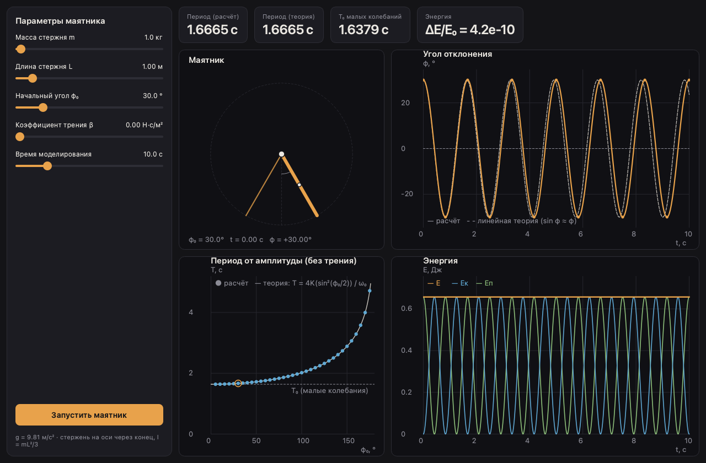

# Физический маятник 🦯

Нативное настольное приложение — лабораторная работа по механике.

Однородный стержень, подвешенный за один конец, отпускают из отклонённого
положения. Программа численно интегрирует уравнение колебаний (без приближения
$\sin\varphi \approx \varphi$) с вязким трением и без него:

$$
I\ddot\varphi = -mg\frac{L}{2}\sin\varphi - \beta\dot\varphi\frac{L^3}{3},
\qquad I = \frac{mL^2}{3}
$$

Слева — параметры маятника, сверху — период (расчёт и теория) и баланс энергии,
ниже — сам маятник, угол $\varphi(t)$ против линейной теории, зависимость
периода от амплитуды против точной формулы через эллиптический интеграл и
энергия $E_к$, $E_п$, $E$ от времени (наведите курсор, чтобы получить точные
значения). Кнопка «Запустить маятник» анимирует колебания в реальном времени.




## Запуск

Нужен [uv](https://docs.astral.sh/uv/):

```shell
curl -LsSf https://astral.sh/uv/install.sh | sh   # или brew install uv
```

Синхронизировать зависимости и запустить приложение:

```shell
uv sync
uv run pendulumswing
```

Эквивалентно: `uv run python -m pendulumswing`.


## Тесты

Оракулы с аналитическими решениями: период малых колебаний, точный период
через эллиптический интеграл, линейное решение с трением во всех трёх режимах,
плюс сохранение энергии без трения и её убывание с трением:

```shell
uv run pytest
```

Линт и автоформатирование:

```shell
uv run ruff check .
uv run ruff format .
```


## Структура

```
src/pendulumswing/
├── physics/       # модель маятника, без зависимостей от интерфейса
│   ├── rod.py     #   стержень: момент инерции, моменты сил, энергия
│   ├── swing.py   #   интегрирование колебаний (DOP853, события поворота φ̇ = 0)
│   └── theory.py  #   теоретические периоды и линейное решение с трением
├── ui/            # нативный интерфейс PySide6
│   ├── controls.py          # панель параметров маятника
│   ├── metrics.py           # плитки результатов
│   ├── plot_canvas.py       # базовый канвас: сетка, оси, перекрестье
│   ├── pendulum_canvas.py   # маятник + анимация
│   ├── angle_canvas.py      # угол от времени против линейной теории
│   ├── period_canvas.py     # период от амплитуды против точной теории
│   └── energy_canvas.py     # энергия от времени
└── app.py         # точка входа: приложение, тёмная палитра, главное окно
```
